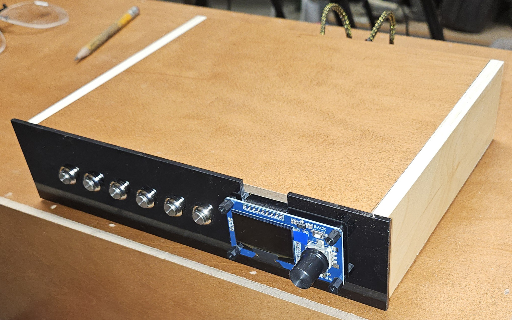
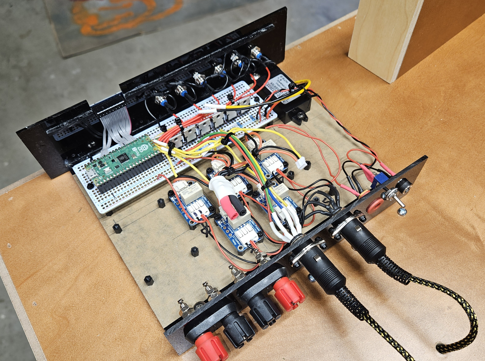

## Model Railroad Lighting Interface (MRLI) 
This is the Micropython code for my model railroad layout lighting interface project.  
It's probably suitable for any LED application where granular control and multiple settings are required.  
I think this project would also be suitable for fish and reptile lighting when the project is synced to a real world clock.  
The code runs on a Rasberry Pi Pico 2.  
  
  
Prototype - front  
  
Prototype - interior  
  
## Features
This program creates lighting effects suitable for a model railroad or diorama.  
It controls up to 5 banks of rgbwc LEDs and controls the on or off value of the layouts scenic lights.  
There is also an audio module that is used for ambient sounds.  
Sound effects can trigger visual effects, allowing for synchronization between the two.  
Front panel controls feature six buttons and a combined OLED and rotary encoder with two additional buttons.  
Five of the six buttons toggle the LED strips on or off, the sixth button toggles the layouts scenic lights on or off.  
The rotary encoder and OLED display are used for navigation.  
There are two additional buttons included with the encoder module. The one marked 'control' toggles the machine in and out of standby state.  
The button marked 'back' is not used.  
This is a stand-alone project, it does not utilize the WiFi feature of the Pico.  
This program controls strip LEDs, not individually programmible LED strips.  

## Lighting Effects  
Different types of lighting effects can be defined by the user.  
Programatically the code conceptualizes two kinds of lighting effects, STATIC and ANIMATED.  
Animated effects move from what's being called a waypoint to the next sequential waypoint.  
At the last waypoint, the effect loops and begins again at the first waypoint.  
A waypoint is similar to what a keyframe is in cartoon animation.  
Each color changes from waypoint to waypoint in a linear manner, there is no 'ease in' or 'ease out' like there is in cartoon animation.  
Static effects have only one waypoint and thus their values do not change over time, but they can be edited at the front panel.  

## Static Lighting Effects  
The LED values for static lighting effects can be changed by the user. The changes are stored
in the STATIC_BUFFER and so are good only as long as the power is on. Permanent changes to the lighting
parameters require editing the dictionaries in the entities file.    
  
## Animated Lighting Effects  
The values of an animated effect can not be changed by the user at the front panel.  
Changes to an animated effect are made by editing the appropriate effect dictionary in the entities file.  
As mentioned, an animated effect moves from waypoint to waypoint and at the end loops back to the beginning.  
There is also a RANDOM value in the effects definition expressed as a decimal percent. This setting will shorten the length of 
the waypoint by a random ammount. Color changes are not effected by the RANDOM value, only the waypoint length.   
  
## Ambient Sounds  
There is also an on-board sound effects card from Adafruit, which is using the UART protocol.  
Sound effects are placed in groups and a group is assigned to each waypoint.  
Sound effects are played sequentially and are randomly selected from the group.  
The output from the sound effects board is sent to an Adafruit amplifier card, which is run in analog mode. Volume is controlled via a pot.  
  
## Visual Effects
For now there is only one visual effect - lightning.  
Visual effects are triggered by and thus synchronized to sound effects.  

## Hardware  
Raspberry Pi Pico 2  
Generic display module:  
(Amazon: AITRIP 1PCS 0.96 Inch OLED Display Module with Buttons EC11 Rotary Encoder IIC Interface LCD Screen Compatible with Arduino(White Color))  
or (Amazon: 1.3 inch White OLED Display Screen Combined with EC11 Rotary Encoder Module IIC Interface for arduino)  
Power Converter (Amazon: DC to DC Power Converter Buck Module 12V 16V (8V to 22V) Buck to 3.3V 2A 3A Max IP67 Waterproof with Overcurrent Overheat Short-Circuit Undervoltage Protection )  
Adafruit STEMMA Relays  
Adafruit Sound Effects Board
Adafruit Stereo 20W Class D Audio Amplifier - MAX9744  
Plugs, switches, buttons, enclosure etc. 
  
## Operation  
This project is built as a state machine, with a bit of MVC mixed in. It is always running a lighting effect, and sound effects are run when the machine is in certain states.  
  
The machine operates in one of 7 states:  
WELCOME - The initial screen presented at startup.  
EFFECTS - A scrollable list of available lighting effects.  
ANIMATED - Displays the values of the RGBWC colors as they change.  
PAUSED - The animated effect is paused.  
STATIC - Displays a selectable list of the RGBWC colors.  
EDIT - Changable value of the selected color.  
STANDBY - Mutes the display, sound, and RGBWC lights.  

## Navigation  
In display state WELCOME:  
  Rotate encoder: display state EFFECTS  
  Single press encoder: display state EFFECTS  
  Double press encoder: None  
  LED bank buttons: None  
  
In display state EFFECTS:  
  Rotate encoder: scroll available effects  
  Single press encoder: select hilighted effect  
  Double press encoder: None  
  LED bank buttons: None  
  
In display state ANIMATED:  
  Rotate encoder: None  
  Single press encoder: display state PAUSED  
  Double press encoder: return to display state EFFECTS  
  LED bank buttons: None  

In display state STATIC:  
  Rotate encoder: scroll colors  
  Single press encoder: display state EDIT  
  Double press encoder: return to display state EFFECTS  
  LED bank buttons: toggle LEDs  

In display state EDIT:  
  Rotate encoder: change color value  
  Single press encoder: save change and return to display state STATIC   
  Double press encoder: None  
  LED bank buttons: toggle LEDs  
  
In display state STANDBY:  
  Rotate encoder: None  
  Single press encoder: None   
  Double press encoder: None  
  LED bank buttons: None  
    
In display state PAUSED:  
  Rotate encoder: None  
  Single press encoder: display state ANIMATED   
  Double press encoder: None  
  LED bank buttons: None  

In any state the standby button will toggle STANDBY    
 
## Third Party Developers
Thank you for providing these hardware libraries.    
They have been lightly edited to fit within the schema of this program.  
  
UASYNCIO:  
https://www.digikey.com/en/maker/projects/getting-started-with-asyncio-in-micropython-raspberry-pi-pico/110b4243a2f544b6af60411a85f0437c  
  
Rotary Encoder Library:  
https://github.com/TTitanUA/micropython_rotary_encoder/tree/main  
  
OLED Display Library:  
https://github.com/stlehmann/micropython-ssd1306/blob/master/ssd1306.py  
https://github.com/CrispStrobe/sh1106-py  
  
Adafruit Sound FX Card:   
https://github.com/mmabey/Adafruit_Soundboard_uPy  
